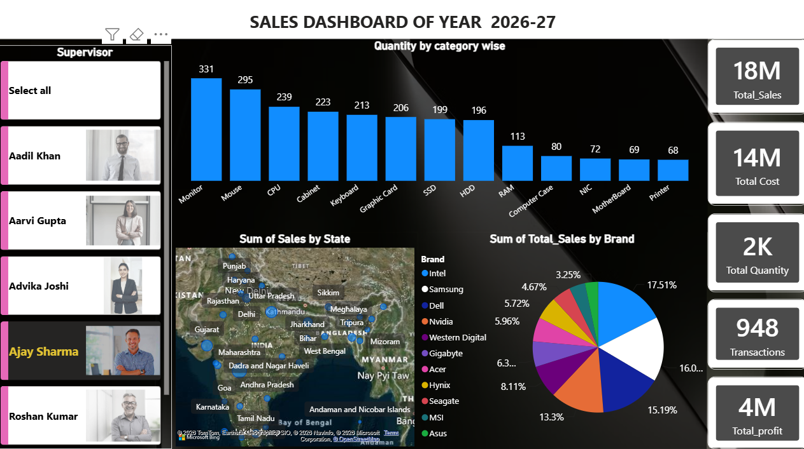

# Techno-Sales-Dashboard
Interactive Sales Analysis Dashboard using Power BI

# Techno Sales Dashboard (2026–27)

##  Project Overview

The Techno Sales Dashboard is an interactive sales analysis project developed using Microsoft Power BI. It provides insights into sales performance, product categories, brands, geographical distribution and supervisor-wise performance.

The dashboard helps users understand key business metrics and explore sales data through interactive visualizations and filters.

## Tools & Technologies

- Microsoft Power BI
- Microsoft Excel
- Power Query
- DAX (Data Analysis Expressions)

## Dataset Information

The project uses an Excel dataset containing 5,110 sales records.

The dataset includes:
- Order Number
- State and State Code
- Customer Name
- Order Date
- Order Status
- Product and Category
- Brand
- Cost and Sales
- Quantity
- Assigned Supervisor

## 📈 Dashboard Features

### 1. Key Performance Indicators (KPIs)
- Total Sales
- Total Cost
- Total Quantity
- Total Transactions
- Total Profit

### 2. Product Category Analysis
Visualizes product quantities across different categories.

### 3. State-wise Sales Analysis
Displays geographical sales distribution across Indian states using a map visualization.

### 4. Brand-wise Sales Analysis
Analyzes the contribution of different brands to total sales.

### 5. Supervisor-wise Filtering
Allows users to filter dashboard data by selecting supervisors, with supervisor profile images.

##  Project Objectives

- Analyze overall sales performance.
- Identify top-performing product categories.
- Understand geographical sales distribution.
- Compare brand-wise sales contributions.
- Explore supervisor-wise sales performance.
- Present business insights through interactive visualizations.

## Dashboard Preview

## Author

Abhiram E.

MCA Graduate | Data Analyst

